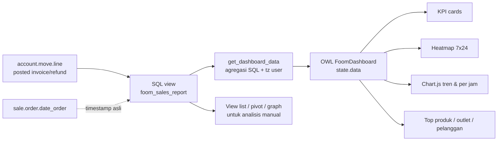

# Design — FOOM Sales Dashboard

Odoo 18.0 · modul `sales_dashboard` · depends: `base`, `web`, `account`, `sale`

## 1. Struktur modul

```
sales_dashboard/
├── __init__.py
├── __manifest__.py
├── models/
│   ├── __init__.py
│   └── foom_sales_report.py
├── security/
│   ├── foom_security.xml
│   └── ir.model.access.csv
├── views/
│   ├── foom_sales_report_views.xml
│   └── foom_dashboard_menus.xml
├── static/
│   ├── lib/chartjs/chart.umd.js
│   ├── src/
│   │   ├── js/dashboard.js
│   │   ├── xml/dashboard.xml
│   │   └── scss/dashboard.scss
│   └── description/icon.png
├── i18n/id.po
└── tests/
    ├── __init__.py
    └── test_sales_report.py
```

## 2. Model layer

### 2.1 `foom.sales.report` (SQL view, `_auto = False`)

Satu baris = satu baris produk pada invoice/credit note yang sudah posted.

| Field | Type | Store | Keterangan |
|---|---|---|---|
| `date_ts` | Datetime | view | Waktu transaksi: `COALESCE(sale_order.date_order, account_move.create_date)`. Dasar semua analisis jam/hari. |
| `invoice_date` | Date | view | Tanggal invoice akuntansi, untuk rekonsiliasi |
| `move_id` | Many2one `account.move` | view | Invoice sumber |
| `move_type` | Selection | view | `out_invoice` / `out_refund` |
| `partner_id` | Many2one `res.partner` | view | Pelanggan |
| `product_id` | Many2one `product.product` | view | Produk |
| `product_tmpl_id` | Many2one `product.template` | view | Template produk (grouping lebih rapi) |
| `categ_id` | Many2one `product.category` | view | Kategori produk |
| `user_id` | Many2one `res.users` | view | Salesperson (`invoice_user_id`) |
| `team_id` | Many2one `crm.team` | view | Sales team → dipakai sebagai "outlet" |
| `journal_id` | Many2one `account.journal` | view | Jurnal |
| `company_id` | Many2one `res.company` | view | Company |
| `quantity` | Float | view | Qty bertanda (negatif untuk retur) |
| `price_subtotal` | Float | view | `-balance` → omzet sebelum pajak, mata uang company |
| `order_count` | Integer | view | Selalu `1`; dipakai `count_distinct(move_id)` di dashboard |

**Kenapa `-balance` dan bukan `price_subtotal`:** `account_move_line.balance` sudah dikonversi ke mata uang company oleh Odoo. Untuk baris pendapatan pada `out_invoice`, balance bernilai kredit (negatif), sehingga `-balance` positif. Untuk `out_refund` balance bernilai debit (positif) sehingga `-balance` negatif — tanda retur jadi otomatis benar tanpa `CASE` tambahan.

### 2.2 Definisi SQL view

```sql
CREATE OR REPLACE VIEW foom_sales_report AS (
    SELECT
        aml.id                                   AS id,
        am.id                                    AS move_id,
        am.move_type                             AS move_type,
        am.invoice_date                          AS invoice_date,
        COALESCE(so.date_order, am.create_date)  AS date_ts,
        am.partner_id                            AS partner_id,
        am.invoice_user_id                       AS user_id,
        am.team_id                               AS team_id,
        am.journal_id                            AS journal_id,
        am.company_id                            AS company_id,
        aml.product_id                           AS product_id,
        pp.product_tmpl_id                       AS product_tmpl_id,
        pt.categ_id                              AS categ_id,
        CASE WHEN am.move_type = 'out_refund'
             THEN -aml.quantity ELSE aml.quantity END AS quantity,
        -aml.balance                             AS price_subtotal,
        1                                        AS order_count
    FROM account_move_line aml
    JOIN account_move am        ON am.id = aml.move_id
    LEFT JOIN product_product pp  ON pp.id = aml.product_id
    LEFT JOIN product_template pt ON pt.id = pp.product_tmpl_id
    LEFT JOIN LATERAL (
        SELECT so2.date_order
        FROM sale_order_line_invoice_rel rel
        JOIN sale_order_line sol ON sol.id = rel.order_line_id
        JOIN sale_order so2      ON so2.id = sol.order_id
        WHERE rel.invoice_line_id = aml.id
        ORDER BY so2.date_order
        LIMIT 1
    ) so ON TRUE
    WHERE am.move_type IN ('out_invoice', 'out_refund')
      AND am.state = 'posted'
      AND aml.display_type = 'product'
);
```

`init(self)` memakai `tools.drop_view_if_exists(self.env.cr, self._table)` lalu `self.env.cr.execute(...)`, sesuai pola `sale.report` / `account.invoice.report` bawaan Odoo. `_rec_name = 'date_ts'`, `_order = 'date_ts desc'`, `_description` diisi.

### 2.3 Timezone

Datetime di Postgres tersimpan sebagai `timestamp without time zone` dalam UTC. Konversi ke waktu lokal user:

```sql
(date_ts AT TIME ZONE 'UTC' AT TIME ZONE %(tz)s)
```

`tz` diambil dari `self.env.user.tz or 'UTC'` dan dikirim sebagai parameter query (bukan string interpolation). Semua `EXTRACT(HOUR ...)`, `EXTRACT(ISODOW ...)`, dan `DATE_TRUNC(...)` dijalankan di atas ekspresi ini.

### 2.4 Method dashboard

Semua method `@api.model`, dipanggil dari OWL lewat service `orm.call`.

```python
def get_dashboard_data(self, date_from, date_to, granularity='auto',
                       company_ids=None, team_ids=None, limit=10)
```

Alur:

1. Normalisasi `date_from`/`date_to` (string ISO tanggal lokal) → rentang UTC untuk perbandingan `date_ts`.
2. Hitung periode pembanding: panjang sama, berakhir tepat sebelum `date_from`.
3. Bangun `WHERE` dinamis: rentang tanggal, `company_id IN allowed_company_ids ∩ company_ids`, `team_id IN team_ids`.
4. Jalankan enam query agregasi (lihat tabel), semuanya `GROUP BY` di SQL.
5. Rakit dict hasil.

| Query | GROUP BY | Dipakai untuk |
|---|---|---|
| `kpi` | — (agregat total, dijalankan 2×: periode aktif & pembanding) | KPI card + growth |
| `heatmap` | `ISODOW`, `HOUR` | Heatmap 7 × 24 |
| `hourly` | `HOUR` | Bar profil per jam |
| `trend` | `DATE_TRUNC(granularity, ...)` | Grafik tren |
| `top_products` | `product_tmpl_id` | Top produk |
| `top_teams` | `team_id` | Top outlet/tim |
| `top_partners` | `partner_id` | Top pelanggan |

Nilai balik:

```python
{
  'currency': {'symbol': 'Rp', 'position': 'before', 'decimals': 2},
  'tz': 'Asia/Jakarta',
  'granularity': 'day',
  'kpi': {
      'amount':   {'value': 0.0, 'previous': 0.0, 'growth': None},
      'orders':   {...}, 'avg_order': {...}, 'customers': {...},
      'quantity': {...}, 'peak_hour': {'label': '19:00–20:00', 'value': 0.0},
  },
  'heatmap': [{'dow': 1, 'hour': 0, 'orders': 0, 'amount': 0.0}, ...],
  'hourly':  [{'hour': 0, 'orders': 0, 'amount': 0.0}, ...],
  'trend':   [{'key': '2026-08-01', 'label': '1 Agu', 'orders': 0, 'amount': 0.0}, ...],
  'top_products': [{'id': 1, 'name': '...', 'orders': 0, 'qty': 0.0, 'amount': 0.0}, ...],
  'top_teams':    [...],
  'top_partners': [...],
  'has_data': True,
}
```

`granularity='auto'` diselesaikan di Python sesuai REQ-13 sebelum query tren dijalankan.

```python
def get_filter_options(self)   # daftar company & sales team yang boleh dilihat user
```

**Pertahanan:** `date_from`/`date_to` di-parse dengan `fields.Date.from_string` (menolak input non-tanggal); `granularity` divalidasi terhadap whitelist `{'hour','day','week','month','year'}` sebelum masuk `DATE_TRUNC`; id company/team di-cast `int`. Tidak ada nilai dari client yang masuk ke SQL sebagai string mentah.

## 3. Alur data



## 4. Layer UI (OWL)

### 4.1 Komponen

| Komponen | Berkas | Tanggung jawab |
|---|---|---|
| `FoomDashboard` | `static/src/js/dashboard.js` | Root client action: state, filter, orkestrasi fetch |
| `KpiCard` | idem | Satu kartu: label, nilai, badge growth |
| `HeatmapGrid` | idem | Grid 7 × 24 murni HTML/CSS + tooltip |
| `TrendChart` | idem | Wrapper Chart.js, mengelola lifecycle canvas |
| `HourlyChart` | idem | Wrapper Chart.js bar |
| `RankList` | idem | Daftar bar horizontal untuk top produk/outlet/pelanggan |

Registrasi: `registry.category("actions").add("sales_dashboard.dashboard", FoomDashboard)`.

Service yang dipakai: `orm` (fetch data), `action` (drill-down ke view list), `notification` (error). Setiap komponen memakai `static template`, `static props`, dan `static components` sesuai gaya Odoo 17+/OWL 2.

### 4.2 Lifecycle Chart.js

Chart.js dimuat dari lib yang di-bundle. Wrapper chart:

- `onMounted` → buat instance pada `useRef("canvas")`.
- `onWillUpdateProps` / `useEffect` pada data → `chart.destroy()` lalu buat ulang, mencegah kebocoran canvas saat filter berubah.
- `onWillUnmount` → `chart.destroy()`.
- `responsive: true`, `maintainAspectRatio: false`, tinggi diatur container.

### 4.3 Filter bar

- Preset periode: Hari ini · 7 hari · 30 hari · Bulan ini · Kuartal ini · Tahun ini · Custom (dua input `date`).
- Dropdown company (multi) — hanya muncul bila user punya >1 company.
- Dropdown sales team (multi).
- Selector granularitas tren: Auto · Jam · Hari · Minggu · Bulan · Tahun.
- Toggle metrik heatmap: Jumlah order ↔ Total omzet.
- Tombol Refresh dan Export CSV.

State dipegang di `useState`; setiap perubahan memicu satu `loadData()` ber-debounce.

### 4.4 Visual & warna

Mengikuti panduan skill `dataviz`: satu palet konsisten, kontras cukup di tema terang maupun gelap, heatmap memakai skala sekuensial single-hue (bukan pelangi), nilai nol dibedakan jelas dari nilai rendah, dan setiap sumbu diberi label satuan. Grafik tren memakai satu warna aksen untuk omzet dan satu warna netral untuk jumlah order pada sumbu kedua.

## 5. Security

| Objek | `group_foom_dashboard_user` | `group_foom_dashboard_manager` |
|---|---|---|
| `foom.sales.report` | read | read |
| Menu FOOM Sales | ✓ | ✓ |

- `ir.model.access.csv` memberi `perm_read=1`, sisanya `0`.
- Record rule `foom_sales_report_company_rule`: `['|', ('company_id','=',False), ('company_id','in',company_ids)]`, `global=True`.
- `sales_team.group_sale_salesman` mendapat `group_foom_dashboard_user` lewat `implied_ids` agar tim sales tidak perlu di-assign manual.

## 6. Dampak migrasi & upgrade

- Modul baru, tidak menyentuh data yang sudah ada. Tidak ada script pre/post migration.
- SQL view dibuat ulang setiap upgrade modul via `init()`; aman untuk dijalankan berulang.
- Uninstall: Odoo menghapus model, dan `drop_view_if_exists` di `init()` menjamin tidak ada view yatim saat reinstall.
- Versi manifest: `18.0.1.0.0`.

## 7. Strategi testing

`tests/test_sales_report.py`, `@tagged('post_install', '-at_install')`, berbasis `TransactionCase`:

| Test | Yang diverifikasi |
|---|---|
| `test_view_excludes_draft` | Invoice draft tidak muncul di report |
| `test_refund_sign_negative` | Credit note menghasilkan `price_subtotal` dan `quantity` negatif |
| `test_order_count_distinct` | Invoice dengan 3 baris dihitung sebagai 1 order |
| `test_timezone_hour_shift` | Invoice pukul 02:00 UTC muncul di jam 09:00 untuk user `Asia/Jakarta` |
| `test_growth_zero_previous` | `growth` bernilai `None` saat periode pembanding nol, bukan error |
| `test_granularity_auto` | Rentang 1 hari → `hour`, 30 hari → `day`, 2 tahun → `month` |

Perintah:

```bash
odoo-bin -d <db> -u sales_dashboard --test-enable --stop-after-init
# atau
pytest -s --odoo-database=<db> --odoo-log-level=warn addons/sales_dashboard/tests
```

## 8. Risiko yang diketahui

| Risiko | Mitigasi |
|---|---|
| Invoice dibuat batch jauh setelah transaksi → jam menyesatkan | Timestamp diambil dari `sale_order.date_order` lebih dulu; `create_date` hanya fallback |
| Invoice tanpa sale order (manual) | Tetap masuk, memakai `create_date`; didokumentasikan di README |
| Sales team kosong pada invoice | "Top outlet" menampilkan grup "Tanpa Tim" alih-alih membuang baris |
| Volume data besar (jutaan baris) | Agregasi penuh di SQL; jika perlu, indeks tambahan pada `account_move_line(move_id, display_type)` disarankan di README |
| Chart.js versi Odoo berubah antar rilis | Lib di-bundle di dalam modul, tidak bergantung path internal Odoo |
